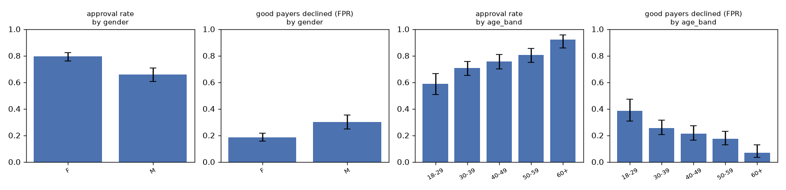

<!-- PROVIDED: copy this file to docs/fairness_analysis.md and fill in every placeholder.
     Use the numbers in reports/fairness/fairness.md (python run.py fairness). -->

# Fairness analysis (Week 6)

**Team:** Group 4

## 1. What we compared, and on which data

We compared the model's decisions across two protected or potentially sensitive attributes: gender (`CODE_GENDER`) and age groups (`AGE_BAND`). The analysis used 1,000 applicants from the validation dataset who were not used to train the model. Using validation data allows us to evaluate the model on applicants it has not previously seen while still having their actual default outcomes available for comparison.

The model used was version 1, with a decision threshold of **0.080**. Applicants with a predicted default probability greater than or equal to 0.080 were rejected, while applicants below that threshold were approved.

Gender (`CODE_GENDER`) is directly included as a model feature. Age bands are created for the fairness analysis using `DAYS_BIRTH`; the underlying `DAYS_BIRTH` variable is also part of the model's feature set. The age bands themselves are used to compare groups in this analysis.

## 2. The table

The following tables summarize the model's approval rates, default rates, average predicted risk scores, true positive rates (TPR), and false positive rates (FPR). The intervals shown for approval rate, TPR, and FPR are 95% Wilson confidence intervals.

**Gender comparison**

| Gender | Applicants | Defaulters | Approval rate (95% CI) | Default rate | Mean score | TPR (95% CI) | FPR (95% CI) |
|---|---:|---:|---:|---:|---:|---:|---:|
| Female (F) | 669 | 38 | 79.4% (76–82%) | 5.7% | 0.072 | 55.3% (40–70%) | 18.5% (16–22%) |
| Male (M) | 331 | 43 | 65.9% (61–71%) | 13.0% | 0.099 | 62.8% (48–76%) | 29.9% (25–35%) |

**Age comparison**

| Age group | Applicants | Defaulters | Approval rate (95% CI) | Default rate | Mean score | TPR (95% CI) | FPR (95% CI) |
|---|---:|---:|---:|---:|---:|---:|---:|
| 18–29 | 143 | 16 | 58.7% (51–66%) | 11.2% | 0.123 | 62.5% (39–82%) | 38.6% (31–47%) |
| 30–39 | 282 | 28 | 70.6% (65–76%) | 9.9% | 0.092 | 64.3% (46–79%) | 25.6% (21–31%) |
| 40–49 | 235 | 18 | 75.7% (70–81%) | 7.7% | 0.074 | 61.1% (39–80%) | 21.2% (16–27%) |
| 50–59 | 216 | 13 | 80.6% (75–85%) | 6.0% | 0.066 | 53.8% (29–77%) | 17.2% (13–23%) |
| 60+ | 124 | 6 | 91.9% (86–96%) | 4.8% | 0.046 | 33.3% (10–70%) | 6.8% (3–13%) |

The fairness report shows an approval-rate gap of 13.51 percentage points between genders and 33.19 percentage points across age groups. The largest FPR gaps are 11.32 percentage points for gender and 31.80 percentage points for age.

**Fairness visualization:**

## 3. The gaps

**Gender:** Male applicants were approved less often than female applicants. The male approval rate was 65.9%, compared with 79.4% for female applicants. Part of this difference is explained by the higher default rate among male applicants: 13.0%, compared with 5.7% for female applicants. However, the model also rejected a larger percentage of male applicants who would have repaid their loans. The FPR was 29.9% for males and 18.5% for females. This suggests that the approval gap is not explained by default rates alone; there is also a difference in how often good-paying applicants are incorrectly rejected.

**Age:** Applicants aged 18–29 had the lowest approval rate at 58.7%, while applicants aged 60 and older had the highest approval rate at 91.9%. Younger applicants also had a higher default rate (11.2%) than applicants aged 60 and older (4.8%). Their FPR was also considerably higher, at 38.6%, compared with 6.8% for the oldest group. This means younger applicants were more likely to default in this dataset, but they were also more likely to be incorrectly rejected despite being good payers. The differences suggest that both the underlying risk of each group and the model's decisions contribute to the approval gap.

**Calibration:** The mean predicted risk scores are relatively close to the actual default rates across most groups. For example, female applicants had a mean score of 7.2% and an actual default rate of 5.7%, while male applicants had a mean score of 9.9% and an actual default rate of 13.0%. The age groups also show relatively close values. This suggests that the model's predicted probabilities are reasonably close to observed default rates at the group level. However, these averages alone do not prove that the model is fully calibrated within every group.

## 4. How sure are we?

The confidence intervals show that some differences are more convincing than others. For gender, the approval-rate intervals do not overlap: females have an interval of 76–82%, while males have an interval of 61–71%. The FPR intervals also do not overlap: 16–22% for females and 25–35% for males. This provides evidence that the gender differences in approval and good-payer rejection are not simply random variation in this validation sample.

For age, the difference between the youngest and oldest groups is also substantial. Their approval-rate intervals do not overlap: 51–66% for ages 18–29 and 86–96% for ages 60+. Their FPR intervals do not overlap either: 31–47% for ages 18–29 and 3–13% for ages 60+. However, many of the intervals for neighboring age groups overlap, so we cannot confidently conclude that every difference between consecutive age groups represents a real difference.

TPR results require more caution. Every age group has fewer than 30 defaulters, and the oldest group has only six. This makes the TPR estimates unreliable and produces wide confidence intervals. The gender TPR intervals also overlap, so the observed gender TPR difference is not clearly established.

A larger validation sample would help determine whether these differences remain consistent. In particular, we need more applicants and more actual defaulters in each age group. The project's analysis flags groups with fewer than 30 defaulters as unreliable. Thirty should be treated as a minimum warning threshold rather than a guarantee of statistical certainty. A formal sample-size and statistical-power analysis would be needed to determine the exact number of applicants required.

## 5. Proxies

The proxy check attempted to predict an applicant's gender using the other 163 features, without directly including `CODE_GENDER`. The resulting AUC was **0.863**. Since an AUC of 0.5 would indicate no predictive ability, 0.863 demonstrates that the other features contain substantial information about gender.

The strongest individual features were:

- `AMT_INCOME_TOTAL`: AUC 0.644
- `CREDIT_INCOME_RATIO`: AUC 0.599
- `DAYS_BIRTH`: AUC 0.593
- `EXT_SOURCE_1`: AUC 0.585
- `BUREAU_AMT_CREDIT_SUM_MEAN`: AUC 0.584

This means that simply removing `CODE_GENDER` would not necessarily eliminate gender-related information from the model. Other variables can act as proxies because income, credit history, age, and financial characteristics may differ between demographic groups. The model could still learn patterns associated with gender through those variables.

Removing `DAYS_BIRTH` would also not automatically eliminate age-related effects if other features contain similar information. Therefore, removing one sensitive feature is not enough to guarantee fairness. We would need to evaluate the remaining features, retrain the model, and repeat the proxy and fairness checks to determine whether the disparities have improved.

## 6. What we recommend

I would **not recommend deploying this model as it currently stands**. The fairness analysis shows meaningful differences in approval rates and FPR across gender and age groups. More importantly, the project’s existing model tests document that changing an applicant's gender can change the predicted probability by as much as 0.118219, exceeding the allowed difference of 0.01. This is a significant concern because gender is directly included in the model.

Before deployment, I recommend investigating the effect of `CODE_GENDER`, `DAYS_BIRTH`, and the features that act as demographic proxies. We should experiment with removing or modifying sensitive features, retraining the model, and comparing the resulting predictive performance and fairness metrics. We should also evaluate whether the threshold of 0.080 contributes to the differences between groups.

If the model is eventually deployed, the lender should continuously monitor approval rates, FPR, TPR, and calibration across demographic groups. These metrics should be included in regular model monitoring and fairness alerts so that changes in applicant populations or model behavior can be identified early.

The final deployment decision should involve the data science team, lending and risk management teams, compliance officers, and legal advisors. A model should not be approved solely because it meets predictive-performance requirements; it must also be evaluated for fairness and regulatory compliance.

There are also important legal considerations. In the United States, the Equal Credit Opportunity Act (ECOA) and Regulation B prohibit discrimination in credit decisions based on protected characteristics, including sex. Age generally cannot be used freely as a creditworthiness factor; however, Regulation B permits age to be considered in certain empirically derived, demonstrably and statistically sound credit-scoring systems, provided applicants aged 62 or older are not treated less favorably because of age. Therefore, the lender should obtain legal and compliance review before using gender or age-related information in a credit decision. Removing these variables alone does not guarantee compliance because other features may act as proxies.

Overall, the model needs additional fairness testing, feature review, and oversight before it should be considered ready for real-world lending decisions.